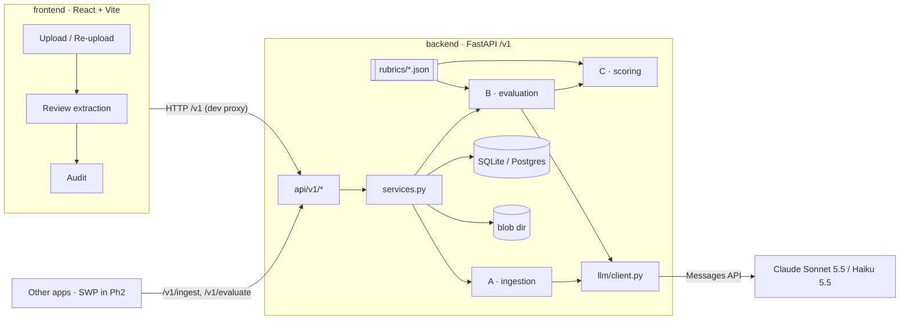
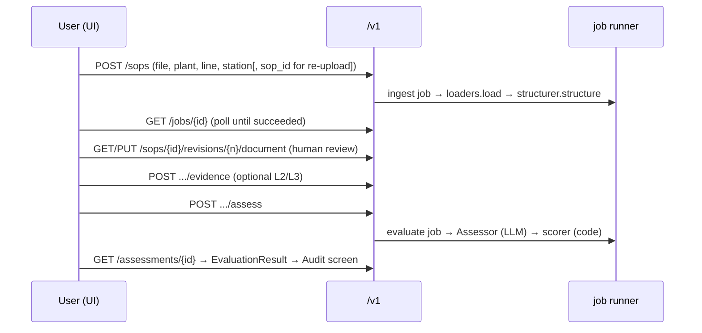

# System overview

Two independent repos side by side: `backend/` (this repo, the API) and `frontend/` (the UI). They share nothing but HTTP `/v1`. The parent folder holds only `docker-compose.yml`, to run both at once.

## Components

- Frontend repo: `src/main.tsx` (routes), `src/pages/*`, typed client `src/api/client.ts`.
- Backend: `app/main.py` (app), `app/api/v1/` (endpoints: one module per area, combined in `routes.py`), `app/services.py` (orchestration + caching), modules A/B/C, `app/jobs/runner.py` (async jobs).

## Main flow (UI)

Black-box callers use the stateless pair `POST /v1/ingest` (file → `SOPDocument`) and `POST /v1/evaluate` (`SOPDocument` + evidence → `EvaluationResult`), then poll `GET /v1/jobs/{id}`; results come back inline in `job.result`.

## Caching (why the score doesn't drift)
- Extraction cache: key = file sha256 + `EXTRACT_PROMPT_VERSION` + provider + model (`ExtractionCache` table).
- Result cache: key = document + evidence + rubric versions + policy version + `PROMPT_VERSION` + `ENGINE_VERSION` + provider + model (`engine.cache_key`). Identical input returns the stored result (`usage.cached_result = true`).

## Deployment
- Local: two processes from two repos: `uv run uvicorn app.main:app --port 8000` here, and `npm run dev` in the frontend repo (:5173, proxies `/v1` to `API_PROXY_TARGET`). Each repo reads its own `.env`.
- Docker: `docker-compose.yml` in the **parent folder** (outside both repos) runs both at once: `api` (this repo's `Dockerfile`, includes LibreOffice for DOCX/PPTX/XLSX rendering, data volume `/data`) and `ui` (node dev server on the frontend repo). Run `docker compose up --build` from the parent folder. Not yet built or tested.
- No production deployment exists yet.

## Phases
- Ph1 (this repo, built): suggestions + scores; human edits the SOP and re-uploads.
- Ph1.5: AI-edited customer PDFs as custom projects (not in this repo).
- Ph2: integration with the SWP SOP-management app; SWP posts `SOPDocument` to `/v1/evaluate`; Change Inbox / Impact / Release panels (currently disabled, labelled "Ph2").
